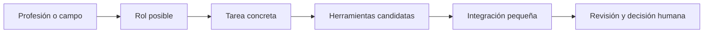
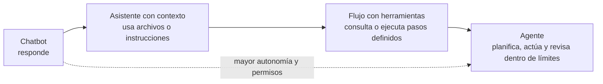
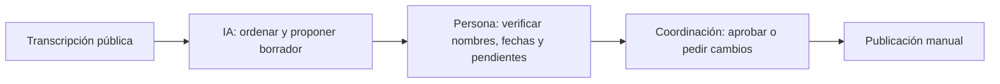

# Clase 6 · IA en el trabajo

**Duración:** 120 minutos  
**Modalidad:** equipos de 3 o 4 personas  
**Producto:** una presentación breve sobre herramientas de IA y su integración en una tarea profesional concreta

## La pregunta de la clase

> Si mañana empezaras una práctica profesional en tu área, ¿qué tarea investigarías para decidir si una herramienta de IA puede ayudarte sin reemplazar tu criterio?

No alcanza con nombrar una herramienta. Al final de la clase van a tener que explicar **qué tarea resuelve, qué herramienta compararon, cómo se integraría al trabajo y qué tendría que revisar una persona**.

## El desafío

Cada equipo va a elegir una profesión, un rol o un campo de trabajo relacionado con sus intereses. Después va a investigar herramientas de IA que podrían ayudar en una tarea concreta de ese campo y va a presentar una propuesta de integración.

La investigación no consiste en armar un catálogo de aplicaciones. Consiste en responder una pregunta de trabajo:

> **¿Podría esta herramienta mejorar una tarea concreta de esta profesión? ¿En qué condiciones y con qué controles?**

Van a comparar al menos **tres herramientas o soluciones**. Pueden pertenecer a la misma categoría o cumplir funciones diferentes. Una de ellas puede ser una herramienta generalista; las otras pueden estar orientadas a una profesión, un tipo de archivo o una etapa del flujo de trabajo.

El resultado tiene que diferenciar:

- lo que la fuente oficial de la herramienta afirma que hace;
- lo que el equipo infiere que podría hacerse con ella;
- lo que todavía habría que probar antes de usarla en un trabajo real.

Los equipos pueden investigar profesiones como diseño, comunicación, programación, derecho, salud, educación, administración, ingeniería, arquitectura, ciencias sociales, turismo, producción audiovisual, comercio o cualquier otra que puedan describir con claridad. No hace falta que la profesión sea la misma para todas las personas del equipo.

## ¿Qué van a aprender?

- Relacionar una herramienta de IA con una tarea laboral concreta, en vez de usarla por moda.
- Investigar capacidades, condiciones de uso y límites en fuentes confiables.
- Comparar herramientas con criterios explícitos.
- Diseñar una integración pequeña y observable dentro de un flujo de trabajo.
- Reconocer qué datos no conviene compartir y qué decisiones deben seguir bajo responsabilidad humana.
- Presentar una recomendación sin confundir una posibilidad con un resultado comprobado.

## Conceptos clave

### Profesión, rol y tarea

Una **profesión** es un campo de trabajo, como enfermería, diseño gráfico o contabilidad. Un **rol** describe una función dentro de una organización, como asistente de comunicación o analista junior. Una **tarea** es una acción concreta, como ordenar entrevistas, resumir una reunión, preparar un borrador o revisar un conjunto de datos.

Para investigar con precisión conviene bajar de la profesión a la tarea:



Por ejemplo, “usar IA en arquitectura” es demasiado amplio. “Preparar una primera lista de observaciones a partir de notas de una visita de obra” permite investigar mejor qué entrada recibe la herramienta, qué salida produce y cómo se revisa.

### Herramienta, modelo e integración

- Una **herramienta** es una aplicación o servicio que permite realizar una tarea. Puede incluir IA junto con otras funciones.
- Un **modelo** es el sistema que procesa información y produce una salida, por ejemplo texto, imágenes, audio, código o una clasificación.
- Una **integración** es la forma en que la herramienta entra en un flujo de trabajo: qué recibe, qué produce, quién revisa el resultado y qué ocurre después.

Una herramienta puede generar un borrador, pero eso no significa que conozca el contexto completo, que tenga acceso a información actualizada o que pueda decidir por una persona. La propuesta tiene que mostrar el lugar exacto que ocupa en el proceso.

### Automatizar y asistir

**Asistir** significa ayudar a una persona en una parte de la tarea. La persona conserva el control de la revisión y la decisión. **Automatizar** significa que un sistema ejecuta uno o más pasos con poca intervención directa en cada ocasión.

En los dos casos hace falta definir límites. Una automatización que envía mensajes, modifica registros o recomienda acciones de alto impacto necesita permisos, datos adecuados, controles y una persona responsable.

### Fuente oficial y prueba propia

Una **fuente oficial** es una página del proveedor, su documentación, su centro de ayuda, sus condiciones de uso o su política de privacidad. Sirve para comprobar qué dice la organización que ofrece la herramienta.

Una **prueba propia** es una pequeña comprobación con datos ficticios o públicos. Sirve para observar si la herramienta responde como se esperaba en el caso elegido.

Ninguna de las dos alcanza por sí sola para afirmar que una herramienta es adecuada para una organización real. La fuente puede describir funciones generales y la prueba puede ser demasiado pequeña. Por eso la recomendación debe incluir qué falta comprobar.

## Mapa inicial de herramientas

Este cuadro sirve para empezar a pensar. No es un ranking ni una lista cerrada. Las funciones, los planes, los permisos, la disponibilidad regional y las condiciones de uso pueden cambiar. Cada equipo tiene que verificar la información en la fuente oficial antes de presentarla como un hecho.

| Tipo de herramienta | Puede ayudar a investigar… | Ejemplos para iniciar la búsqueda |
|---|---|---|
| Asistente conversacional | redactar, resumir, comparar, explicar o revisar | ChatGPT, Claude, Gemini, Microsoft Copilot |
| Búsqueda y síntesis con fuentes | explorar información y localizar referencias | Perplexity y buscadores con funciones de IA |
| Documentos y conocimiento | organizar materiales, consultar fuentes y producir borradores | NotebookLM, Notion AI y herramientas integradas en suites de oficina |
| Diseño, imagen y presentación | idear piezas, adaptar formatos y preparar borradores visuales | Canva, Adobe Firefly, herramientas de presentaciones |
| Audio y reuniones | transcribir, resumir y extraer acciones | herramientas de transcripción y asistentes de reuniones |
| Programación y análisis | explicar código, proponer cambios y explorar datos | GitHub Copilot, asistentes de código y notebooks con funciones de IA |
| Automatización | conectar aplicaciones y disparar pasos de un flujo | Zapier, Make y automatizadores con funciones de IA |

La pregunta no es “¿cuál es la mejor herramienta?”. Es “¿cuál parece adecuada para esta tarea, con estos datos, este nivel de riesgo y este flujo de trabajo?”.

## Herramientas para distintos campos profesionales

Las siguientes herramientas funcionan como puntos de partida para investigar. Cada enlace lleva a la página oficial del producto. La presencia de una herramienta en este cuadro no significa que sea la mejor opción, que esté disponible para todas las cuentas o que pueda usarse con información real sin una revisión previa.

| Campo profesional | Herramienta para explorar | Tarea posible para investigar | Pregunta de integración |
|---|---|---|---|
| Abogacía y servicios legales | [Harvey](https://www.harvey.ai/) | Analizar documentos, organizar hechos o preparar un primer borrador de investigación jurídica | ¿Qué fuentes y citas debe verificar una persona antes de usar el resultado? |
| Diseño gráfico | [Adobe Firefly](https://www.adobe.com/products/firefly.html) | Crear variaciones visuales, editar una imagen o explorar una dirección estética | ¿Qué decisiones de marca, autoría y aprobación siguen siendo del equipo de diseño? |
| Computación y desarrollo | [GitHub Copilot](https://github.com/features/copilot) | Explicar código, proponer una modificación pequeña o ayudar a detectar un error | ¿Cómo se prueba el código y cómo se revisan seguridad, dependencias y licencias? |
| Turismo y planificación de viajes | [Mindtrip](https://mindtrip.ai/) | Comparar opciones de viaje y armar un itinerario según preferencias y restricciones | ¿Qué información debe confirmarse con proveedores, fechas y condiciones reales? |
| Ventas y relación con clientes | [HubSpot AI](https://www.hubspot.com/products/artificial-intelligence) | Ordenar consultas, resumir interacciones o preparar un borrador de seguimiento | ¿Qué datos del cliente se pueden usar y quién aprueba el mensaje antes de enviarlo? |
| Gestión de proyectos | [Asana AI](https://asana.com/product/ai) | Convertir objetivos o notas en tareas, responsables y próximos pasos | ¿Quién decide las prioridades, fechas y dependencias que el sistema propone? |
| Edición de video y audio | [Descript](https://www.descript.com/) | Transcribir, editar un corte a partir del texto, quitar repeticiones o preparar subtítulos | ¿Qué errores de transcripción, tono, imagen o consentimiento deben revisarse antes de publicar? |

### Cómo leer este cuadro

Cada herramienta está asociada a una **tarea posible**, no a una profesión completa. Por ejemplo, una herramienta para turismo puede ayudar a ordenar opciones de viaje, pero no reemplaza la confirmación de disponibilidad, el conocimiento del destino ni la responsabilidad frente a una persona viajera.

Las páginas oficiales sirven para comprobar qué declara el proveedor. La integración profesional necesita además una prueba con un caso ficticio o público, un criterio de calidad y una definición de qué persona revisa y aprueba el resultado. Los planes, límites, permisos, idiomas y funciones pueden cambiar.

## Del chatbot al agente: distintos niveles de trabajo con IA

Un **chatbot** es una interfaz de conversación. Recibe un mensaje y devuelve una respuesta. Puede explicar, redactar, resumir o proponer ideas, pero el trabajo suele avanzar cuando la persona vuelve a pedir algo y decide qué hacer con la respuesta.

Un **agente de IA** es un sistema organizado alrededor de un objetivo que puede planificar pasos, usar herramientas, consultar información, mantener un estado de trabajo y continuar con acciones dentro de límites definidos. La diferencia no está en que “hable mejor”, sino en que puede participar en un flujo de varios pasos con herramientas y cierta autonomía.

Entre los dos extremos hay formas intermedias. No toda herramienta que tiene un botón de IA es un agente, y no todo flujo automático necesita un agente.



### Comparación rápida

| Forma de trabajo | Qué hace | Ejemplo profesional | Qué debe controlar una persona |
|---|---|---|---|
| Chatbot | Responde a una solicitud | Redacta tres asuntos para un correo de ventas | Datos, tono, exactitud y elección de la versión final |
| Asistente con contexto | Trabaja sobre archivos, instrucciones o una base de conocimiento indicada | Resume un manual interno y separa procedimientos de dudas | Fuentes usadas, información faltante y datos confidenciales |
| Flujo con herramientas | Ejecuta pasos previamente definidos entre aplicaciones | Toma un formulario, clasifica la consulta y crea una tarea | Reglas, permisos, errores y casos que deben derivarse a una persona |
| Agente | Decide el siguiente paso dentro de un objetivo y puede usar varias herramientas | Investiga opciones, arma una propuesta y solicita aprobación antes de enviarla | Objetivo, herramientas disponibles, límites, registro de acciones y aprobación |

### Un mismo trabajo en cuatro niveles

Caso: una oficina de turismo recibe una consulta sobre un viaje.

1. **Chatbot:** responde preguntas generales sobre una propuesta escrita en el mensaje.
2. **Asistente con contexto:** compara la consulta con un documento que contiene servicios, restricciones y datos ficticios.
3. **Flujo con herramientas:** registra la consulta, busca opciones en fuentes conectadas y prepara una ficha para revisión.
4. **Agente:** interpreta el objetivo, consulta varias herramientas, propone un itinerario y deja la reserva o el envío final en manos de una persona.

En cada nivel cambia el tipo de trabajo y también el riesgo. Cuando el sistema puede acceder a información externa, modificar registros, enviar mensajes o comprometer dinero, la propuesta necesita permisos acotados, trazabilidad y una aprobación clara. “Puede hacerlo” no significa “debe hacerlo sin supervisión”.

### Qué buscar en una herramienta que produce tareas

Antes de llamar “agente” a una solución, conviene identificar:

- **Objetivo:** qué resultado intenta alcanzar.
- **Herramientas:** qué aplicaciones, archivos, buscadores o funciones puede usar.
- **Estado:** qué recuerda durante el proceso y qué queda registrado.
- **Autonomía:** qué decide por sí misma y qué pasos están fijados de antemano.
- **Permisos:** qué puede leer, crear, modificar, enviar o publicar.
- **Aprobaciones:** en qué momentos una persona debe revisar o autorizar.
- **Criterio de finalización:** cómo sabe que terminó y cómo informa lo que no pudo resolver.

Una propuesta profesional puede empezar con un chatbot o un flujo fijo y aumentar su autonomía solo si las pruebas muestran que el beneficio justifica la complejidad y el riesgo. En muchos casos, una asistencia acotada y revisable es más adecuada que un agente autónomo.

## Cómo evaluar una herramienta

Usen estos criterios para comparar, no solo la cantidad de funciones que anuncia cada servicio.

| Criterio | Pregunta para investigar |
|---|---|
| Tarea | ¿Qué parte concreta del trabajo ayuda a realizar? |
| Entrada | ¿Qué hay que darle: texto, audio, imagen, tabla, código o acceso a otra aplicación? |
| Salida | ¿Qué produce y en qué formato? |
| Calidad | ¿Cómo comprobaríamos si el resultado sirve? |
| Integración | ¿En qué paso del flujo entraría y qué haría una persona antes y después? |
| Datos | ¿Qué información se cargaría? ¿Incluye datos personales, confidenciales o sensibles? |
| Control | ¿Qué permisos requiere? ¿Puede enviar, publicar, borrar o modificar algo? |
| Accesibilidad | ¿Se puede probar con los recursos, idioma, dispositivos y conectividad disponibles? |
| Condiciones | ¿Qué límites, costos, cuentas o restricciones declara la fuente oficial? |
| Alternativa | ¿Qué haría el equipo si esta herramienta no estuviera disponible? |

## Recorrido y tiempos

| Etapa | Qué van a hacer | Tiempo |
|---|---|---:|
| 1. Introducción | Ubicar la IA dentro del trabajo actual y futuro | 10 min |
| 2. Entender | Pasar de una profesión amplia a una tarea investigable | 15 min |
| 3. Observar | Ver una investigación y una integración en vivo | 20 min |
| 4. Actividad principal | Investigar herramientas y preparar una presentación | 45 min |
| 5. Presentar | Exponer resultados y discutir decisiones | 20 min |
| 6. Cerrar | Volver a la pregunta inicial y registrar un criterio | 10 min |
| **Total** | | **120 min** |

---

## 1. Introducción: IA como parte del trabajo · 10 minutos

La inteligencia artificial ya no aparece solamente como una herramienta aislada para escribir o generar imágenes. Se está incorporando a tareas de investigación, comunicación, programación, diseño, ventas, organización y análisis. En el trabajo que viene, muchas personas van a trabajar con herramientas de IA integradas a las aplicaciones y procesos de su profesión.

Ese conjunto de herramientas puede pensarse como un **stack de trabajo**: las aplicaciones que una persona usa para producir, organizar información, comunicarse, analizar datos y tomar decisiones. El stack no es igual para todas las profesiones. Una abogada, un diseñador, una desarrolladora, una persona que trabaja en turismo y una responsable de proyectos necesitan resolver tareas diferentes.

Por eso, prepararse para el trabajo no consiste en aprender una única aplicación ni en acumular cuentas. Consiste en reconocer tareas, investigar qué herramientas pueden asistirlas, entender cómo se integran y saber qué debe revisar una persona antes de aceptar un resultado.

La pregunta que orienta la clase es:

> Si mañana empezaras una práctica profesional en tu área, ¿qué tarea investigarías para decidir si una herramienta de IA puede ayudarte sin reemplazar tu criterio?

La respuesta se construirá durante la actividad principal, a partir de una profesión, una tarea, herramientas disponibles y una propuesta de integración.

---

## 2. De una profesión a una tarea · 15 minutos

Antes de buscar herramientas, una profesión amplia se convierte en una tarea concreta.

### Ejemplo

| Demasiado amplio | Más investigable |
|---|---|
| IA para una futura abogada | Preparar un primer esquema de preguntas para una entrevista con un cliente, usando solo información ficticia |
| IA para un diseñador | Proponer tres variantes de texto para una pieza de difusión, a partir de un brief aprobado |
| IA para un docente | Convertir apuntes públicos en una guía de repaso y marcar qué conceptos debe revisar el docente |
| IA para un programador | Explicar un error de un código pequeño y sugerir una modificación que después debe probarse |
| IA para una arquitecta | Ordenar observaciones de una visita de obra y separar hechos de pendientes, sin inventar mediciones |

Una buena tarea para la investigación es acotada, tiene una entrada y una salida identificables, y permite definir cómo revisar el resultado.

La actividad principal va a tomar esta forma: profesión o campo → rol → tarea → herramientas posibles → integración y revisión humana.

---

## 3. Observamos una investigación en vivo · 20 minutos

La demostración docente usa un caso ficticio para mostrar el proceso. Los datos del caso no representan una organización real.

### Caso de demostración

Una estudiante de comunicación colabora con un centro cultural. Después de una reunión recibe una transcripción y necesita preparar un primer borrador de agenda para revisión de la coordinadora. La [transcripción ficticia de la reunión](Material%20de%20apoyo%20-%20Transcripción%20reunión%20cultural.txt) contiene información confirmada, datos pendientes, interrupciones y propuestas que todavía no fueron aprobadas.

La tarea concreta es:

> **Convertir una transcripción de reunión en un borrador de agenda, separando datos confirmados, propuestas y pendientes.**

La herramienta no publica la agenda, no confirma horarios y no reemplaza la revisión de la coordinadora.

### Paso 1 · Definir la tarea antes de buscar

La demostración muestra por qué “¿qué IA sirve para comunicación?” es una pregunta demasiado amplia y la reemplaza por:

> ¿Qué herramientas pueden ayudar a ordenar una transcripción y producir un borrador de agenda editable, manteniendo visibles los datos confirmados, las propuestas y los pendientes?

### Paso 2 · Pedir un mapa de búsqueda

Se puede usar una IA conversacional para proponer categorías y términos de búsqueda:

```text
Estoy investigando una tarea ficticia de comunicación cultural: convertir una
transcripción de reunión en un borrador de agenda editable. La agenda debe
separar los datos confirmados, las propuestas y los pendientes, y siempre será
revisada por una persona.

Proponé tres categorías de herramientas que podría comparar y una lista de
criterios para investigarlas. No elijas una herramienta por mí, no inventes
funciones y aclarame qué tendría que verificar en la documentación oficial.
```

La respuesta es un plan de búsqueda, no una evidencia. Toda afirmación sobre una herramienta debe comprobarse en su documentación oficial.

### Paso 3 · Consultar fuentes oficiales

Para cada candidata, la revisión consulta su página oficial o documentación y registra:

- qué función declara;
- qué entradas y salidas menciona;
- qué integraciones o permisos aparecen;
- qué información sobre datos, privacidad o límites está disponible;
- qué parte de la tarea sigue necesitando revisión humana.

Si una fuente no responde una pregunta, se anota **“no verificado”**. No se completa el vacío con una suposición.

### Paso 4 · Diseñar una integración mínima

El flujo de trabajo queda representado así:



La integración es pequeña y observable: la IA prepara un borrador; una persona verifica la información; otra persona aprueba antes de publicar.

### Paso 5 · Pedir una crítica

Antes de considerar terminada la propuesta, se aplica una revisión:

```text
Revisá esta propuesta de integración como si fueras responsable de calidad.
Señalá:
1. una afirmación que todavía no está respaldada por una fuente;
2. un dato que no convendría cargar en la herramienta;
3. un error que deberíamos detectar antes de publicar;
4. una prueba pequeña para evaluar si el borrador ahorra trabajo sin perder precisión.
No supongas que la IA tiene acceso a información que no le dimos.
```

El foco de la demostración no es encontrar una ganadora. Es mostrar cómo pasar de una tarea a criterios, fuentes, integración y prueba.

---

## 4. Actividad principal: investigar y preparar una presentación · 45 minutos

### Consigna

Elijan una profesión o campo de trabajo, definan una tarea concreta de esa profesión, investiguen tres herramientas de IA que podrían asistirla y preparen una presentación breve que recomiende una integración posible. La presentación debe diferenciar lo que está respaldado por fuentes oficiales, lo que el equipo infiere y lo que todavía necesita ser probado.

La presentación puede tener cinco diapositivas:

1. Profesión, rol y tarea elegida.
2. Tres herramientas investigadas, con sus enlaces oficiales y la tarea que cada una podría asistir.
3. Herramienta o combinación recomendada y flujo de integración: qué recibe, qué produce y qué ocurre después.
4. Revisión humana, datos que no conviene cargar, riesgo principal y control necesario.
5. Prueba inicial y aspecto que todavía no pudieron verificar.

La investigación puede apoyarse en una IA para encontrar categorías o palabras clave, pero las funciones de cada herramienta deben comprobarse en su página oficial o documentación. Para las pruebas se usan datos ficticios o públicos.

**Resultado:** una presentación lista para exponer, no una tabla comparativa.

---

## 5. Presentaciones y debate · 20 minutos

Cada equipo presenta en **3 minutos**:

1. la profesión, el rol y la tarea elegida;
2. las tres herramientas comparadas;
3. la herramienta o combinación recomendada;
4. el flujo de integración;
5. un riesgo, un control y una prueba inicial;
6. una cosa que todavía no pudieron verificar.

Mientras escuchan, los demás equipos anotan una propuesta que les parezca transferible y una pregunta que harían antes de implementarla.

Después de cada presentación, usen una o dos de estas preguntas:

- ¿Qué parte del trabajo mejora realmente y cuál queda igual?
- ¿Qué pasaría si la herramienta se equivoca de una forma difícil de detectar?
- ¿Qué datos se necesitarían y cuáles no deberían cargarse?
- ¿La integración ahorra trabajo o solo cambia el trabajo de lugar?
- ¿Quién tiene autoridad para aprobar la salida?
- ¿Qué evidencia necesitarían para recomendarla en una organización real?

No comparen las propuestas solo por la cantidad de herramientas. Comparen la claridad de la tarea, la calidad de las fuentes y la responsabilidad del diseño.

---

## 6. Cerramos · 10 minutos

Vuelvan a la pregunta de apertura:

> Si mañana empezaras una práctica profesional en tu área, ¿qué tarea investigarías para decidir si una herramienta de IA puede ayudarte sin reemplazar tu criterio?

Cada persona completa por escrito:

- La tarea que ahora investigaría mejor es…
- Para elegir una herramienta no alcanza con que…
- Una fuente que necesito consultar es…
- La persona debe revisar…
- Antes de usar una integración real, probaría…

El cierre retoma esta idea:

> **Integrar IA en el trabajo no es agregar una aplicación. Es rediseñar una tarea con un propósito, un límite, una forma de revisar y una persona responsable.**

## Entrega del equipo

La entrega es una presentación breve. Tiene que incluir:

- profesión, rol y tarea concreta;
- comparación de tres herramientas;
- al menos una fuente oficial por herramienta;
- herramienta o combinación elegida y justificación;
- flujo de integración antes, durante y después de la IA;
- criterio para revisar la calidad;
- riesgo y control;
- datos que no cargarían;
- prueba inicial;
- afirmación que todavía no pudieron verificar;

## Criterios de revisión

| Criterio | Logrado cuando… |
|---|---|
| Tarea | El caso describe una acción concreta y una salida observable. |
| Investigación | Las funciones principales se apoyan en fuentes oficiales y se distinguen hechos de inferencias. |
| Comparación | Se contrastan tres candidatas con criterios claros. |
| Integración | Se explica qué entra, qué produce la IA y qué hacen las personas antes y después. |
| Responsabilidad | Se identifican datos a cuidar, un riesgo y un control concreto. |
| Verificación | Se propone una prueba y se reconoce lo que todavía no está confirmado. |
| Comunicación | La presentación permite entender la recomendación sin depender de frases promocionales. |

## Para investigar con cuidado

- No carguen nombres, teléfonos, historias clínicas, documentos privados, claves, información laboral confidencial ni datos de clientes.
- Para probar una herramienta usen datos ficticios, públicos o modificados para que no identifiquen a una persona.
- Revisen la dirección web y distingan la página oficial de una reseña o una publicación patrocinada.
- No presenten como hecho una función que solo apareció en una respuesta de IA.
- No confundan una demostración que “funcionó una vez” con una herramienta validada para un proceso real.
- Si una herramienta puede publicar, enviar mensajes, modificar archivos o tomar decisiones, indiquen qué permisos necesitaría y dónde queda la aprobación humana.
- Las condiciones de uso, los límites y las funciones pueden cambiar. Anoten la fecha de consulta y vuelvan a verificar antes de implementar.

